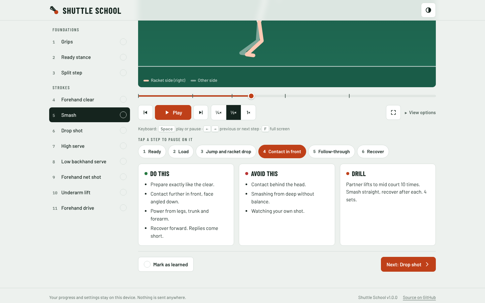
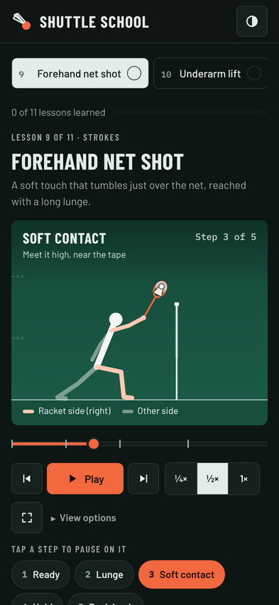

# Shuttle School

[](https://github.com/buvann-11/Shuttle-school/actions/workflows/ci.yml)
[](LICENSE)

Learn badminton strokes visually, step by step, without a coach.

**Try it:** https://buvann-11.github.io/Shuttle-school/

<p>
  
  
</p>

## What it does

Each lesson is an animated side-on figure that performs the stroke, broken into named steps with a coaching cue for each one.

- **11 lessons** across Foundations (grips, ready stance, split step) and Strokes (clear, smash, drop, high and low serves, net shot, lift, drive).
- **Study the motion**: drag the seek bar frame by frame, jump step to step, slow it to ¼ speed, show the racket path or every step at once, or go full screen.
- **Left-handed mode** mirrors every lesson.
- **Read steps aloud** for practising without looking at the screen.
- **Progress** is saved on the device, and returning learners resume at their next unlearned lesson.
- **Installable and offline**: install it like an app and use it on court with no signal. It tells you when an update is ready.
- **Light and dark themes**, following the device or set manually.
- **Private by design**: no accounts, no tracking, nothing leaves the device.

### Keyboard

| Key     | Action                |
| ------- | --------------------- |
| `Space` | Play or pause         |
| `←` `→` | Previous or next step |
| `F`     | Full screen           |

## Quality bar

| Area          | How it is enforced                                                                                                  |
| ------------- | ------------------------------------------------------------------------------------------------------------------- |
| Types         | TypeScript `strict` plus `noUncheckedIndexedAccess` and `exactOptionalPropertyTypes`                                |
| Lint          | ESLint `strictTypeChecked`, React Hooks and `jsx-a11y`; zero warnings allowed                                       |
| Unit tests    | 120+ Vitest and Testing Library tests; coverage gate of 90% lines (currently ~97%)                                  |
| Content       | Every lesson is validated against a Zod schema (timing, joint names, shuttle contact frame, unique ids)             |
| End-to-end    | 45 Playwright tests across laptop, Android and iPhone viewports: learning flow, seek bar, persistence, offline mode |
| Accessibility | axe-core (WCAG 2.2 AA) in light and dark themes, no sideways scroll, minimum tap sizes, full keyboard control       |
| Security      | Strict Content Security Policy (no `unsafe-inline`), production dependencies audited in CI                          |
| Lighthouse    | Desktop: 100 in all four categories. Mobile: Performance 90+, Accessibility, Best Practices and SEO 100             |

## Tech stack

React 19 · TypeScript · Vite · React Router · Canvas 2D · Vitest + Testing Library · Playwright + axe-core · GitHub Actions · GitHub Pages

## Getting started

Requires Node.js 20.19 or newer (see `.nvmrc`).

```bash
npm install
npm run dev          # http://localhost:5173
```

| Script                  | Purpose                                           |
| ----------------------- | ------------------------------------------------- |
| `npm run dev`           | Development server with hot reload                |
| `npm run build`         | Type-check and build to `dist/`                   |
| `npm run preview`       | Serve the production build                        |
| `npm test`              | Unit and component tests                          |
| `npm run test:coverage` | Tests with the coverage gate                      |
| `npm run test:e2e`      | Playwright end-to-end and accessibility tests     |
| `npm run lint`          | ESLint                                            |
| `npm run check`         | Everything CI runs before a build, in one command |

First time running end-to-end tests: `npx playwright install chromium`.

## Project structure

```
src/
  app/               App shell: layout, header, footer, routes, error and not-found pages, update notice
  components/        Reusable UI: Button, Segmented, Switch, ProgressBar, icons
  content/           lessons.json, its Zod schema, and the typed lesson library
  engine/            Framework-free animation core
    pose.ts            Forward kinematics for the stick figure
    timeline.ts        Keyframe timing, easing and step sampling
    shuttle.ts         Shuttle flight in and out of the contact point
    render.ts          Canvas drawing for figure and grip scenes
  features/lessons/  Lesson page: player, stage, seek bar, controls, steps, notes
  lib/               Persistent stores, install/update handling, full screen, media queries, speech
e2e/                 Playwright tests
scripts/             Build plugins: offline service worker, CSP, font preloads, 404 page
```

### How a lesson becomes an animation

1. A lesson in `src/content/lessons.json` is a list of keyframes. Each keyframe names a step, a coaching cue, how long the move into it takes, and the joint angles that differ from the ready stance.
2. `timeline.ts` turns durations into a looping timeline and finds the current step at any moment.
3. `pose.ts` blends neighbouring keyframes and runs forward kinematics to get joint positions.
4. `render.ts` draws the court, figure, racket, trail and shuttle on a canvas sized to the element and the screen's pixel density.

The animation only runs while it is on screen and the tab is visible, and it starts after the page has settled, so it never slows down loading.

Adding a lesson is a content change only; see [CONTRIBUTING.md](CONTRIBUTING.md).

## Deployment

Every push and pull request runs CI. When a commit on `main` passes every check (format, lint, types, unit tests, build and end-to-end tests), the same workflow builds the site and deploys it to GitHub Pages.

**First-time setup** (once per repository): **Settings → Pages → Build and deployment → Source: GitHub Actions**.

The build uses hash routing and a configurable base path, so it runs on any static host:

```bash
BASE_PATH=/ VITE_SITE_URL=https://example.com/ npm run build   # then upload dist/
```

`VITE_SITE_URL` sets the canonical URL and the link-preview image address.

## Roadmap

- Course map with units and unlock rules
- Shadow-rep counter and timed footwork drills
- Court guide: footwork patterns, shot paths with shuttle drag, serving rules
- Rules and technique quiz
- Backhand strokes, jump smash, defensive block, doubles formations

## Contributing

Bug reports, technique corrections and pull requests are welcome. See [CONTRIBUTING.md](CONTRIBUTING.md) and [CHANGELOG.md](CHANGELOG.md).

## License

[MIT](LICENSE) © B. Sai Buvann
